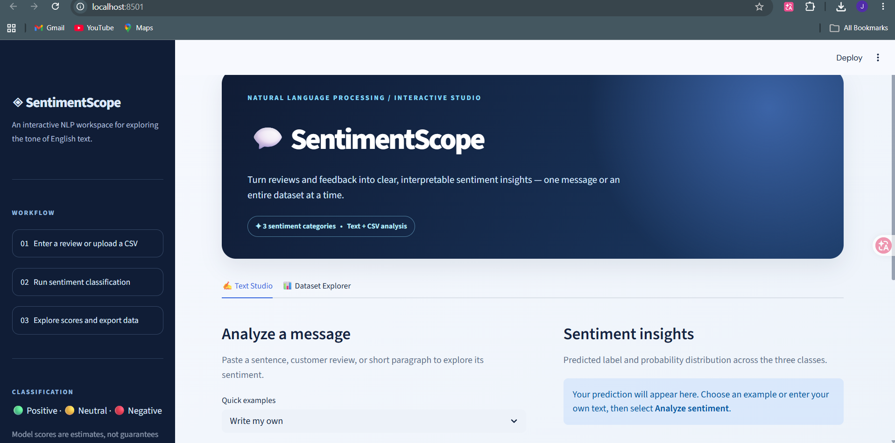
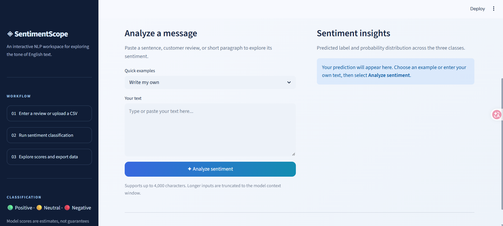
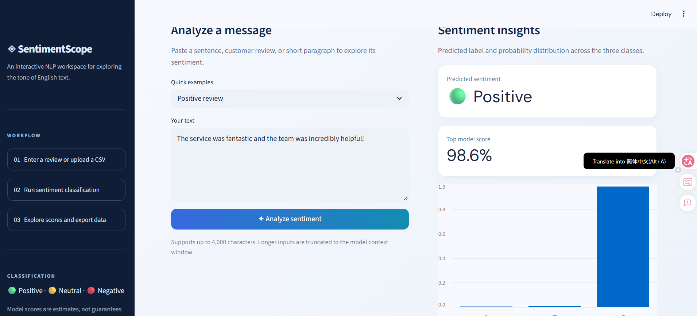
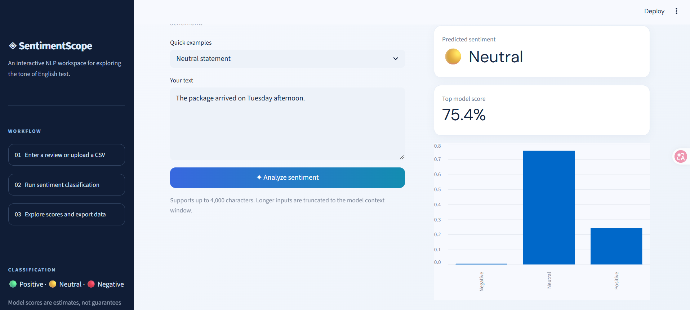
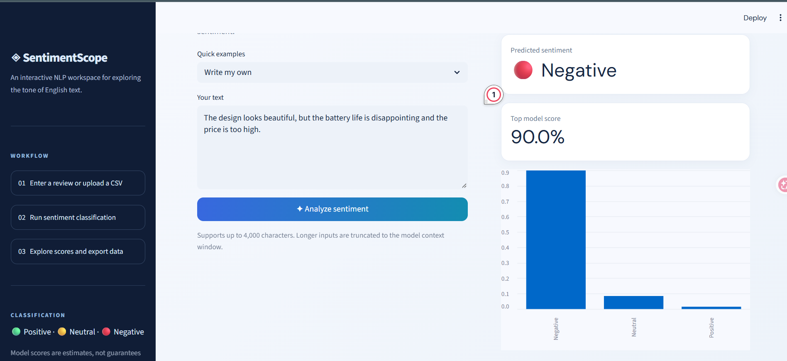
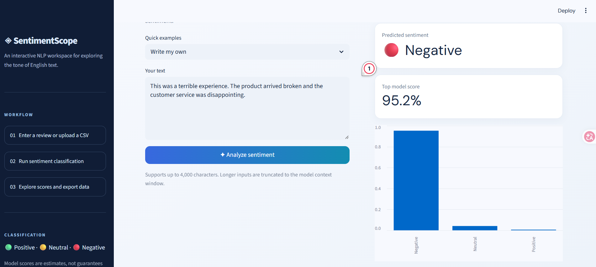
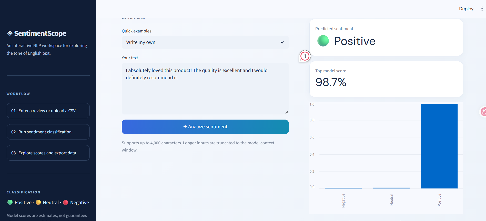
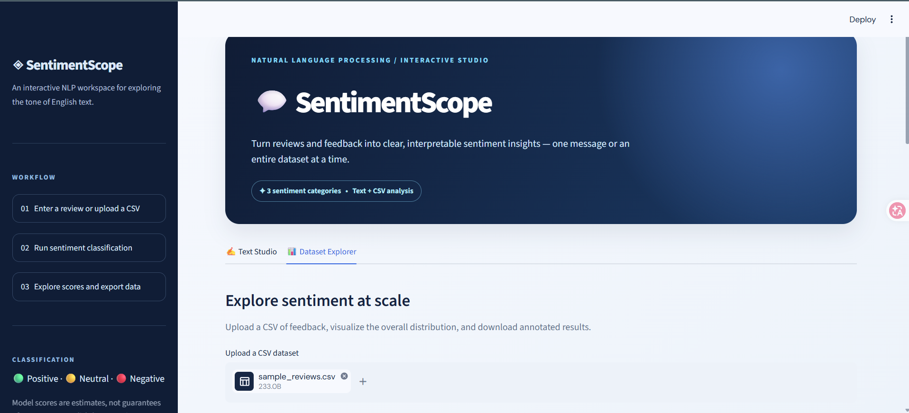
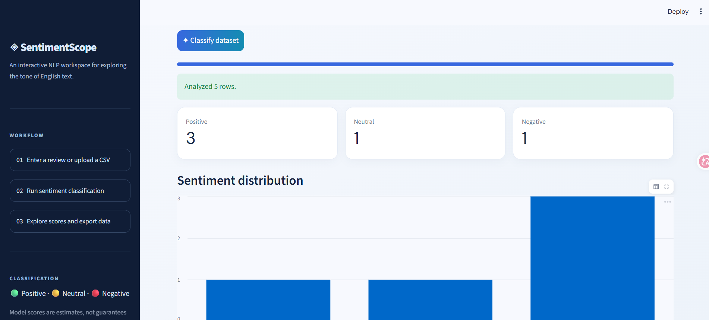
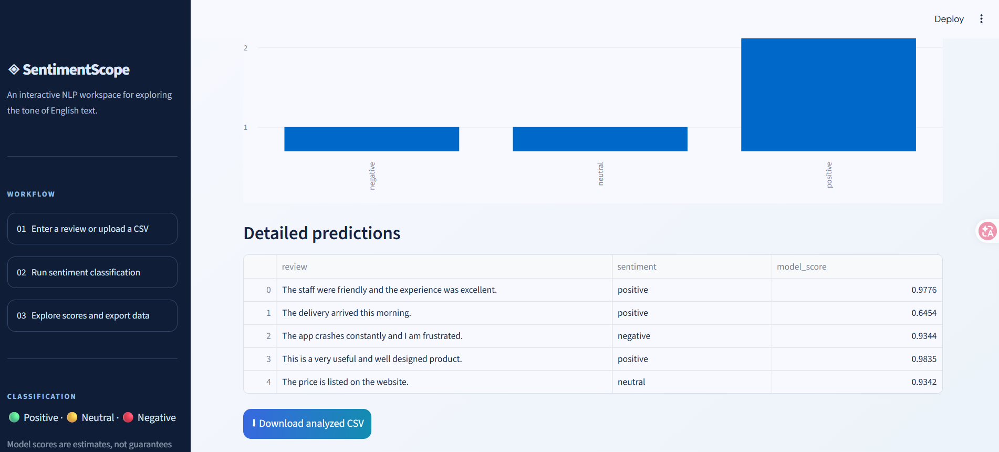

# SentimentScope — NLP Sentiment Analysis Dashboard

A modern interactive Python application for **three-class English sentiment classification** using Streamlit and a pretrained transformer model. Analyze individual reviews or upload a CSV to explore sentiment distribution and export predictions.

## Features
- Positive, neutral, and negative predictions with model probability scores
- Polished NLP studio with a dark navigation sidebar, responsive layout, and two analysis tabs
- CSV batch classification (up to 100 rows) and downloadable results
- Sentiment distribution charts and sample reviews
- Input validation and unit tests

## Technology
Python · Streamlit · Hugging Face Transformers · PyTorch · Pandas

**Model:** [`cardiffnlp/twitter-roberta-base-sentiment-latest`](https://huggingface.co/cardiffnlp/twitter-roberta-base-sentiment-latest). This project **uses existing pretrained model weights**; it does not train or fine-tune a new model. The weights are downloaded on first inference (internet required). Check the model card for its original training data, licensing, and limitations.

## Quick start (Windows)
Install Python 3.10+ and open a terminal inside the folder containing `app.py`.

```powershell
python -m pip install -r requirements.txt
python -m streamlit run app.py
```

Open `http://localhost:8501` if the browser does not open automatically. First classification can take longer while the model downloads.

## Run tests
```powershell
python -m unittest discover -s tests -v
```

## CSV workflow
1. Open the **Dataset Explorer** tab (beside **Text Studio**, directly below the header).
2. Upload `sample_reviews.csv` or your own UTF-8 CSV.
3. Select the text column and click **Classify dataset**.
4. Review charts and download the results.

## Screenshots

Screenshots captured from the locally running Streamlit application. Model scores are illustrative of individual predictions, not an accuracy benchmark.

### Homepage


### Text input


### Positive review


### Neutral statement


### Negative review


### Mixed review


### Custom negative review


### Custom positive review


### CSV upload in Dataset Explorer


### Batch classification and sentiment distribution


### Detailed predictions and CSV export


The sample CSV batch run shown above classified five reviews (three positive, one neutral, one negative). These are example predictions, not an accuracy evaluation.

## Limitations
- English sentiment only; sarcastic and domain-specific text may be misclassified.
- Probabilities are model scores, not calibrated guarantees.
- Text is truncated to the model's maximum sequence length.
- Batch processing is limited to 100 rows to keep the demo responsive.
- Intended as an educational application, not production decision-making software.

## Project learning outcomes
Integrating transformer inference into an end-user application, input preprocessing, result visualization, CSV handling, caching, validation, and testing.
